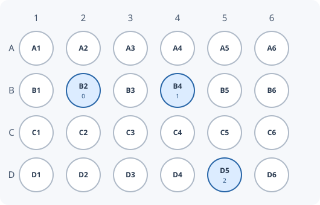
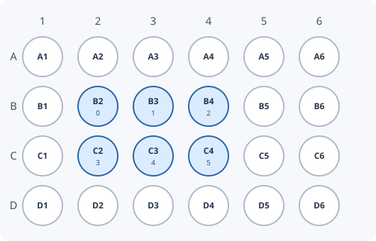
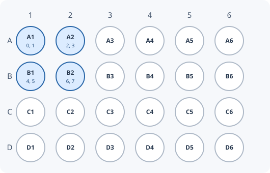
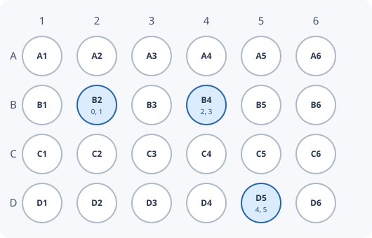
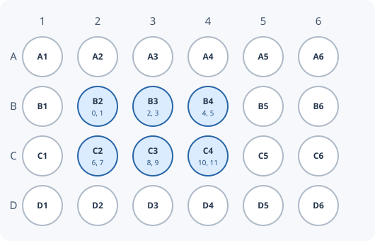
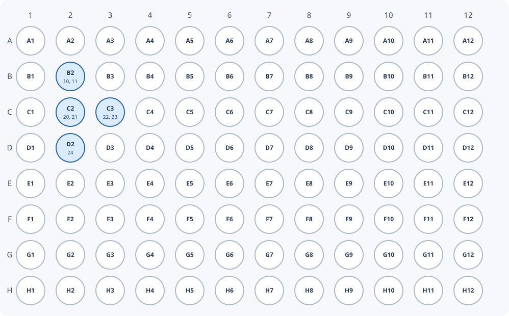

# Wellplate factory

Use `WellplateFactory` to describe a plate and map ND2 sequence frames to its
wells. The plate geometry is required to calculate physical well indexes.

## One frame per well

Start by describing the plate, then add wells in the same order as the ND2
sequence frames. The first well receives frame 0, the next receives frame 1,
and so on. The factory calculates each well's physical index from the plate
geometry.

```python
import limnd2

factory = limnd2.WellplateFactory(name="My plate", rows=4, columns=6)
factory.addWell("A1")  # Frame 0
factory.addWell("A2")  # Frame 1
factory.addWell("B1")  # Frame 2
factory.addWell("B2")  # Frame 3
```

??? example "Show example wellplate"
    

Highlighted wells contain images; the number beneath each well name is its
ND2 sequence frame index.

The same mapping can be added in one call:

```python
factory = limnd2.WellplateFactory(rows=4, columns=6)
factory.addWell(["A1", "A2", "B1", "B2"])  # Frames 0, 1, 2, 3
```

??? example "Show example wellplate"
    

The wells do not need to start at A1 or fill the entire plate:

```python
factory = limnd2.WellplateFactory(rows=4, columns=6)
factory.addWell(["B2", "B4", "D5"])  # Frames 0, 1, 2
```

??? example "Show example wellplate"
    

For a rectangular region, provide the first and last wells. Both endpoints
are included; wells are visited row by row, from left to right:

```python
factory = limnd2.WellplateFactory(rows=4, columns=6)
factory.addWellRect("B2", "C4")  # 6 wells, frames 0–5
# B2 → 0, B3 → 1, B4 → 2, C2 → 3, C3 → 4, C4 → 5.
```

??? example "Show example wellplate"
    

## Multiple frames per well

**Use `frameCount` only when the ND2 has more than one sequence frame in each
well.** Multiple image channels can be part of the same sequence frame; they
do not necessarily require `frameCount`.

For example, to assign two consecutive frames to each well, the first mapping
can be written as four calls or as one list:

```python
factory = limnd2.WellplateFactory(rows=4, columns=6)
factory.addWell("A1", frameCount=2)  # Frames 0, 1
factory.addWell("A2", frameCount=2)  # Frames 2, 3
factory.addWell("B1", frameCount=2)  # Frames 4, 5
factory.addWell("B2", frameCount=2)  # Frames 6, 7
```

??? example "Show example wellplate"
    

```python
factory = limnd2.WellplateFactory(rows=4, columns=6)
factory.addWell(["A1", "A2", "B1", "B2"], frameCount=2)
# A1 → frames 0, 1; A2 → 2, 3; B1 → 4, 5; B2 → 6, 7.
```

??? example "Show example wellplate"
    

The sparse and rectangle examples work the same way:

```python
factory = limnd2.WellplateFactory(rows=4, columns=6)
factory.addWell(["B2", "B4", "D5"], frameCount=2)
# B2 → frames 0, 1; B4 → 2, 3; D5 → 4, 5.
```

??? example "Show example wellplate"
    

```python
factory = limnd2.WellplateFactory(rows=4, columns=6)
factory.addWellRect("B2", "C4", frameCount=2)
# B2 → frames 0, 1; B3 → 2, 3; ...; C4 → 10, 11.
```

??? example "Show example wellplate"
    

These helpers assume frames are **consecutive within each well**. If your
sequence uses another order, such as imaging all wells before returning to
the first well, use `addItem` with explicit sequence indexes. For non-standard
axis naming, use `addItem` with numeric coordinates rather than well strings.

By default, the factory assigns frame indexes starting at 0 and continues
counting up as wells are added. Use `seqStart` to specify the first frame
index for an `addWell` or `addWellRect` call:

```python
factory = limnd2.WellplateFactory(rows=8, columns=12)
factory.addWell("B2", seqStart=10, frameCount=2)  # Frames 10, 11
factory.addWellRect("C2", "C3", seqStart=20, frameCount=2)
# C2 → frames 20, 21; C3 → frames 22, 23.
factory.addWell("D2")  # Frame 24
```

??? example "Show example wellplate"
    

After an explicit `seqStart`, subsequent automatic indexes continue after
the highest frame index used; adding an earlier index does not move the
counter backwards. `seqStep` can specify a positive interval between indexes.

## Write the metadata

After adding the mappings, create a `Wellplate` and append it to an existing
ND2 file:

```python
plate = factory.create()

with limnd2.Nd2Writer("output.nd2", append=True) as writer:
    writer.wellplate = plate
```

The resulting object can also be passed as `wellplate` to
[`convert_sequence_to_nd2`](convert_sequence.md), so the metadata is written
during conversion. See [wellplate metadata](wellplate.md) for reading.

::: limnd2.wellplate_factory
    options:
      heading_level: 3
